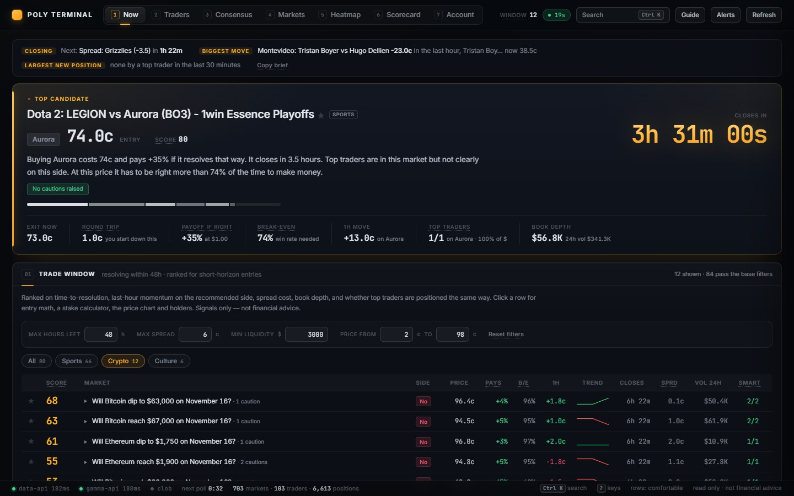
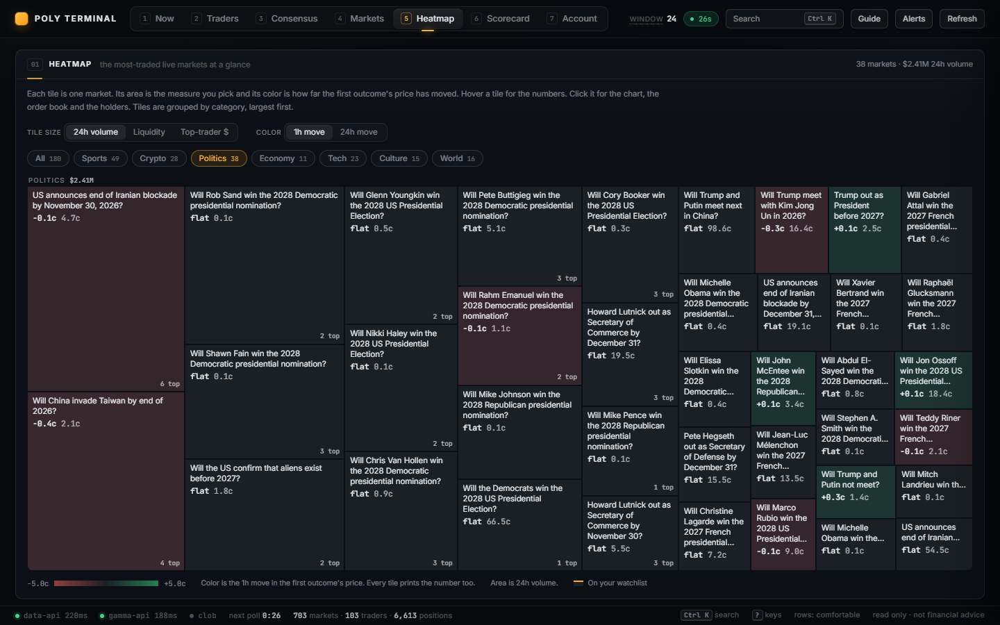
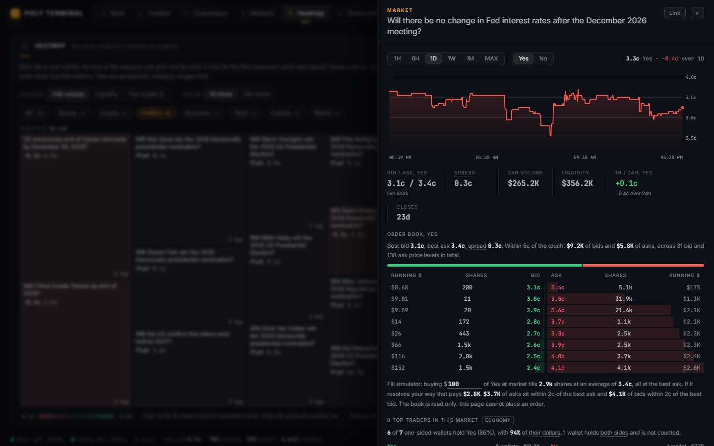
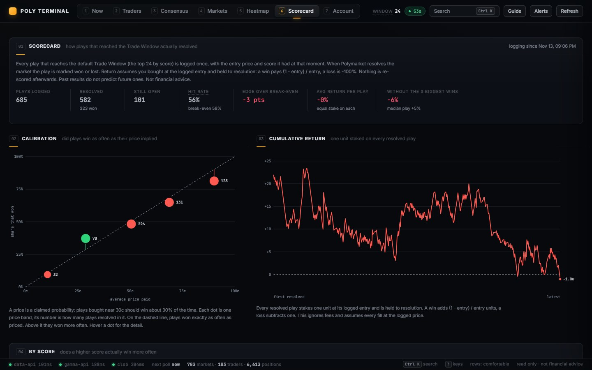
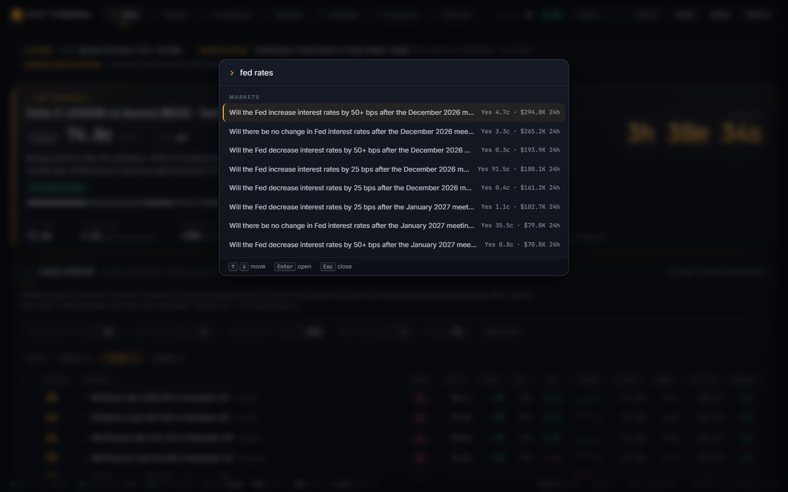
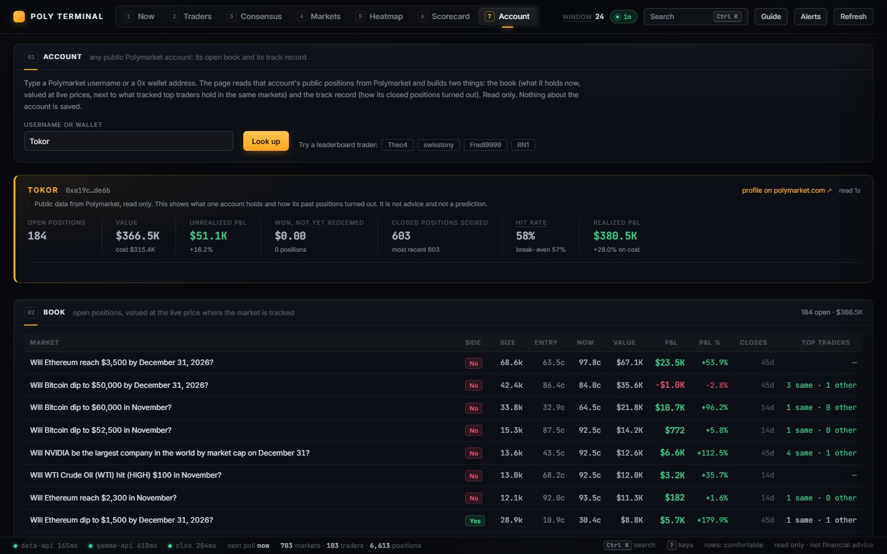
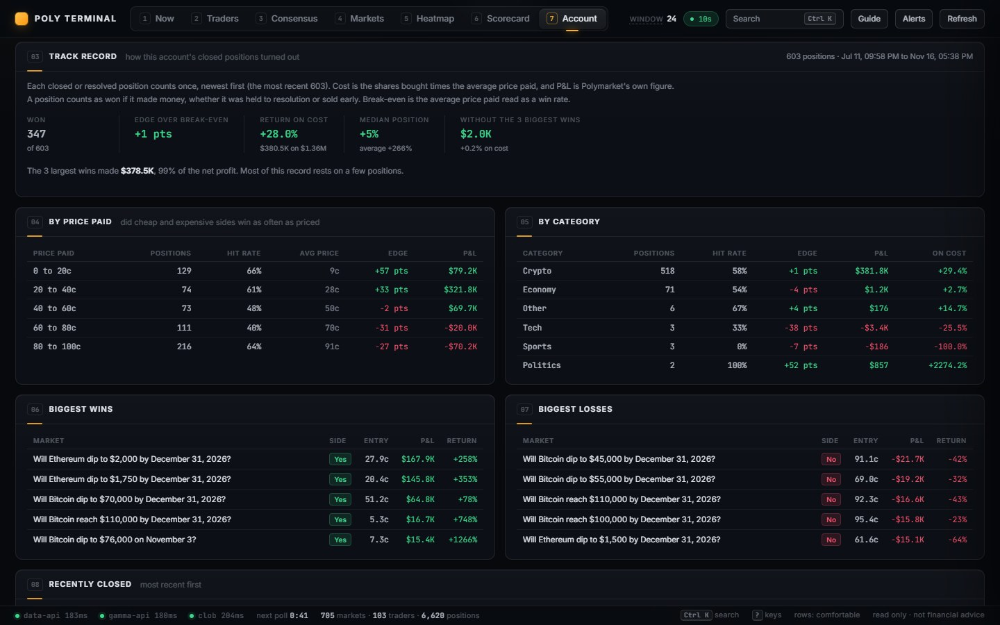

# Poly Terminal

A local, read-only data terminal for Polymarket, the prediction market. It reads Polymarket's public APIs once a minute, tracks what the top leaderboard traders hold, ranks short-horizon markets with a transparent score, maps the market as a heatmap, shows the live order book for anything you open, and looks up the book and track record of any public account.

The question behind it: **does what top traders hold, or a simple score built on price, momentum and liquidity, say anything about how a market resolves?** The Scorecard logs every pick the score makes and checks it against the real result, so the tool keeps an honest record of its own accuracy. So far it does not beat the market (see [Scorecard](#scorecard)).

It never places orders and never asks for keys or logins. Nothing here is financial advice. Plain Node and one HTML file: no dependencies, no build step, no account.



| | |
|---|---|
|  |  |
| **Heatmap.** Every tile is a market: area is volume, color is the move. | **Market panel.** Chart, live order book, fill simulator, holders. |
|  |  |
| **Scorecard.** Did the scores actually win? Calibration and return. | **Command palette.** Ctrl K searches every market and trader. |
|  |  |
| **Account.** Any public account's open book, valued live. | **Track record.** How its closed positions turned out, by price paid and category. |

## Start it

```
node server.js
```

Then open http://127.0.0.1:8890. That is all: plain Node (18 or newer), no install step, no dependencies.

- The first screen fills in after the first poll (about 10 to 30 seconds).
- If the page stays on the boot screen, it tells you why. The usual cause is a network that filters polymarket.com (some school and office networks do). The server keeps retrying every minute and the page fills in on its own once Polymarket is reachable.
- History is kept in the `data` folder: price history, PnL history, order flow, the position baseline and the scorecard. Delete a file there to reset that piece. The folder is created on first run and is not part of the repository. Accounts looked up on the Account tab are never written to it.

## What each tab shows

**Now**
- *Briefing*: one line on what closes soon, the biggest move in the last hour, and the largest new position by a top trader. "Copy brief" puts the briefing, the top plays and the biggest moves on the clipboard as Markdown.
- *Top candidate*: the best play that clears a minimum bar, with a plain-language verdict and caution chips. If nothing clears the bar it says so.
- *Trade Window*: markets resolving within 48 hours, ranked by score. Filter by hours left, spread, liquidity, price range and category. Open a row for entry math, the score breakdown, a stake calculator, the price chart, the live order book and who holds it.
- *Momentum*: the largest one-hour moves.
- *Resolving Soon*: markets top traders hold that close within 24 hours.
- *Order Flow*: position changes by tracked traders since the last poll. NEW, ADD, TRIM, EXIT, and SHIFT (the consensus side flipped).
- *Large Trades*: every public trade above a size you pick ($1K, $5K, $10K or $25K), from any wallet on Polymarket, newest first. Traders on a tracked leaderboard are marked.

**Traders**: the six leaderboards (24h, week, all time, by PnL or by volume). Click a row for that trader's book. "PnL / Vol" is profit divided by volume, not a return on capital. The badge beside a name says which kind of board the wallet came from.

**Consensus**
- *High Agreement*: markets where at least 60% of one-sided top wallets hold the same side, with the share of dollars beside the share of wallets, and what they paid against what you would pay now.
- *Crowded Markets*: the twelve markets with the most top traders in them.
- *High Conviction*: one or two wallets holding far more than their usual size. Higher risk, little confirmation.

**Markets**: every market a tracked trader holds. Search, filter by category, sort by any column, show or hide markets past their end time.

**Heatmap**: the 180 most-traded live markets as a treemap, grouped by category. Tile area is 24h volume, liquidity or top-trader dollars. Tile color is the one-hour or 24-hour move in the first outcome's price, and every tile prints the number as well. Hover for the detail, click for the market.

**Scorecard**: every play that reached the Trade Window, and whether it won. Hit rate and average return by score bucket and by category, always with the sample size, and a clear warning while the sample is too small to mean anything. Two charts sit on top: a calibration plot (did plays bought near 30c win about 30% of the time) and the cumulative return of staking one unit on every resolved play. It also shows the average without the three biggest wins and the median play, because a few cheap winners can carry the average.

**Account**: type any public Polymarket username or 0x wallet address.
- *Book*: the account's open positions, valued at the live price where the market is tracked, with how many tracked top traders hold the same side and the other side.
- *Track record*: its most recent closed and resolved positions (up to about 800). Hit rate against break-even, return on cost, the median position, profit without the three biggest wins, and splits by price paid and by category, plus its biggest wins and losses.
- The address bar carries the account (`#acct/a/<name>`), so a link reopens it. "Track record" in any trader panel opens that wallet here.

**Everywhere**
- **Ctrl K** (or Cmd K) opens the command palette. Type to search every live market and tracked trader, jump to a tab, or run a command.
- Click a trader name to open their book in a side panel. Click a market anywhere to open its panel: price chart, live quote, order book, holders, and the other markets in the same event.
- The order book shows the top eight levels on each side with running dollars, the dollars resting near the touch, and a fill simulator: type a stake and it walks the asks to show the average price you would actually pay.
- The address bar always names the tab and any open panel, so a link reopens the same view. "Link" in a panel copies it.
- The status bar at the bottom shows which data source answered last and how fast, when the next poll lands, and the size of the tracked universe.
- Click a star to add a market to the watchlist, or follow a trader. The watchlist strip sits under the header on every tab. The Alerts button sets the move threshold and turns on browser notifications.
- Labels with a dotted underline explain themselves on hover or click.
- Your tab, sorts, filters, stake, watchlist, row density and alert settings are remembered in the browser.

## Keys

| Key | What it does |
|---|---|
| Ctrl K | Search markets and traders, or run a command |
| 1 to 7 | Switch tabs |
| Up, Down (or j, k) | Move through the rows of the current tab |
| Enter (or o) | Open the selected row |
| s | Star the selected market or follow the selected trader |
| / | Jump to the filter of the current tab |
| Left, Right | Page through High Agreement on the Consensus tab |
| ? | Show the key list |
| Esc | Close whatever is open |

## How each score is calculated

### Trade Window score (0 to 100)

A market is considered only if it resolves in 9 minutes to 48 hours, is accepting orders, has at least $3,000 of liquidity, a spread of 6c or less, at least $8,000 of 24h volume, and the suggested side is priced between 2c and 98c.

The suggested side is the one most top traders hold. If no top trader is in the market, it is the side the last hour's price move favors.

| Part | Max | How it is earned |
|---|---|---|
| Time | 26 | Full marks at 1 to 3 hours left. 92% at 3 to 8h, 75% under 1h, 70% at 8 to 16h, 50% at 16 to 28h, 32% beyond. |
| Momentum | 22 | The one-hour move on the suggested side, full marks at +5c or more, zero if flat or negative. |
| Spread | 14 | Full marks at a zero spread, falling to zero at 6c. |
| Depth | 12 | log10 of liquidity, full marks near $160,000. |
| Volume | 10 | log10 of 24h volume, full marks at $1,000,000. |
| Top traders | 16 | Zero unless top traders lean to the suggested side. Otherwise (wallets on that side / 8, capped at 1) times the average of their share of wallets and their share of dollars. |

Plays under 30 are dropped. The six parts are drawn as the bar in each row drawer and in Top candidate.

Related numbers:
- **Entry** is the ask for the first outcome, or one minus the bid for the second. **Exit** is the bid, or one minus the ask.
- **Round trip** is entry minus exit: what you lose buying and selling straight back.
- **Pays** is (1 - entry) / entry: profit as a percent of stake if the side wins.
- **Break-even** is the entry price read as a win rate. A 40c entry needs to be right more than 40% of the time.

### Top candidate

The highest-scoring play with a score of 50 or more and none of the blocking cautions: closes in under 15 minutes, pays under 15 percent, a spread or round trip of 4c or more, or the price moving 1c or more against the side in the last hour. Softer cautions (top traders split or leaning the other way, no top traders present, a thin book under $10,000) are shown as chips but do not block.

### Smart money counts

Wallets come from the top 25 of each of the six leaderboards. A wallet holding both sides of the same market is flagged and left out of the side counts and dollar totals. "x/y" means x of the y one-sided wallets hold the side shown. The dollar share is the leading side's share of one-sided dollars.

### High Agreement score (0 to 100)

Needs at least 3 one-sided wallets with 60% or more on one side.

- up to 30 for the number of one-sided wallets (full at 12)
- up to 45 for agreement, where agreement is the average of the wallet share and the dollar share (zero at 50%, full at 100%)
- up to 25 for dollars committed (log scale, full at $100,000)

"They paid" is the size-weighted average entry of the wallets on the leading side.

### High Conviction score (0 to 100)

For markets with one or two top wallets.

- up to 50 for size against that wallet's own average position (full at 4 times)
- up to 30 for dollars committed (log scale, full at $10,000)
- 20 for a solo position, 10 for a pair

### Scorecard

The top 24 plays by score are logged once per market side, with the entry and score at that moment. A play past its end time is checked against Polymarket every 3 minutes until it resolves. A win returns (1 - entry) / entry, a loss returns -100%. Hit rate is wins over resolved plays. Edge is hit rate minus the average break-even of the same plays. Any group with fewer than 30 resolved plays is marked too small.

- **Calibration** groups resolved plays by the price paid (0 to 20c, 20 to 40c, and so on) and plots each group's average entry against the share that won. A price is a claimed probability, so a well-priced group sits on the diagonal.
- **Cumulative return** stakes one unit on every resolved play in the order they resolved. It ignores fees and assumes every fill at the logged entry.
- **Without the 3 biggest wins** and the **median play** are there because returns on binary markets are lopsided. A side bought at 5c that wins returns +1,900%, so two or three longshots can turn the average positive while most plays lose. When the average and the typical play disagree, the page says so.

**Results so far** (November 16, 2026, three days of logging): 582 resolved plays, a 56% hit rate against a 58% break-even, so an edge of -3 points. The average play returned -0.2%, and without its three biggest wins (+1,487%, +1,289% and +809%) it returned -6%. Just over half the plays won, so the median play is a small win (+5%), but every loss costs the whole stake. A gap of 3 points is still within what luck alone could produce at this sample size, and on this evidence the score does not beat the market price.

### Account track record

Built from the account's public positions with status CLOSED or REDEEMABLE (resolved, not yet redeemed), newest first. Each position counts once.

- **Cost** is shares bought times the average price paid. **P&L** is Polymarket's own realized plus unrealized figure.
- A position **won** if it made money, whether it was held to resolution or sold early.
- **Break-even** is the average price paid read as a win rate, and **edge** is hit rate minus break-even. Because positions sold early count by P&L, edge here is a rough guide, not a calibration test.
- **Return on cost** is total P&L over total cost. The **median position** and **profit without the 3 biggest wins** show how much of the record rests on a few large wins.
- The book counts how many tracked top traders hold the same side and the other side of each open position. Wallets holding both sides are left out.

### Fill simulator

The simulator spends your stake against the asks in the public order book, best price first, and reports the shares bought, the average price, and how much worse that is than the best ask. If the visible book cannot absorb the stake it says how much would fill. It is arithmetic on a snapshot: the book can change before any real order lands.

## Order Flow rules

- A wallet is compared against its own previous snapshot only. A wallet that just joined a leaderboard, or whose fetch failed last time, becomes a baseline and reports nothing that poll.
- NEW is a position that was not there last poll. ADD is a size increase of more than 15% and 200 shares. TRIM is a reduction of the same size that leaves some held. EXIT is a full close.
- An EXIT is confirmed with a direct lookup and is never reported for a market that has simply settled.

## Data sources

- `data-api.polymarket.com/v2`: leaderboard, positions (open, closed and redeemable, for the Account tab), tokens (resolution), prices-history (charts), trades (Large Trades), value.
- `gamma-api.polymarket.com/markets`: the live market universe, prices, order book top, end dates, tags (categories).
- `gamma-api.polymarket.com/public-search`: turns a username typed on the Account tab into its wallet. Only an exact name match is accepted.
- `clob.polymarket.com/book`: the full public order book for one outcome, fetched only when a market is open.

All three are public and need no key. Categories come from Gamma's tags when they are present, otherwise from matching the market title.

Prices and books are near real time, not tick level. Verify every price on Polymarket before acting. Prediction markets can resolve against you and you can lose your entire stake.

## Settings

Everything is optional and set through environment variables.

| Variable | Default | What it does |
|---|---|---|
| `POLY_PORT` | 8890 | Port the page is served on (bound to 127.0.0.1 only) |
| `POLY_POLL_MS` | 60000 | How often Polymarket is polled |
| `POLY_DATA_DIR` | `./data` | Where history is kept |
| `POLY_DATA_API`, `POLY_GAMMA_API`, `POLY_CLOB_API` | Polymarket | Point the server at a local stand-in for testing |

## Security

- The server listens on 127.0.0.1 only and answers only requests addressed to `127.0.0.1`, `localhost` or `[::1]` on its port. A web page that points its own domain at your machine (DNS rebinding) gets a 421 and cannot read the API.
- The only routes that change anything (`/api/refresh`) refuse requests sent from another site.
- It holds no keys, logins or wallets, and cannot place, change or cancel an order. Everything it reads is public.
- Text from Polymarket (market titles, usernames) is escaped before it reaches the page.

## Design notes

The interface follows a few fixed rules: one dark palette, amber reserved for the single number you act on in each section, red and green used only for direction, and no motion unless you caused it. Every section sits in its own panel with a header strip, text importance is shown by brightness rather than extra colors, and numbers are set in a fixed-width face so columns line up. Words use Inter and numbers use JetBrains Mono, both bundled in `fonts/` so nothing loads from the internet. Interface ideas were borrowed from open terminals I studied while building this, in particular the command palette and market heatmap in [OpenTerminal](https://github.com/ErTasselli/OpenTerminal), the copyable daily brief in [Polymarket Desk](https://github.com/juliosuas/polymarket-desk), and the habit of labelling where every number came from in [OpenTerminalUI](https://github.com/Hitheshkaranth/OpenTerminalUI). No code was taken from any of them.

## License

MIT. See [LICENSE](LICENSE). The bundled typefaces, Inter and JetBrains Mono, are under the SIL Open Font License; their license files are in `fonts/`.

This project is not affiliated with Polymarket. It reads public data only.
